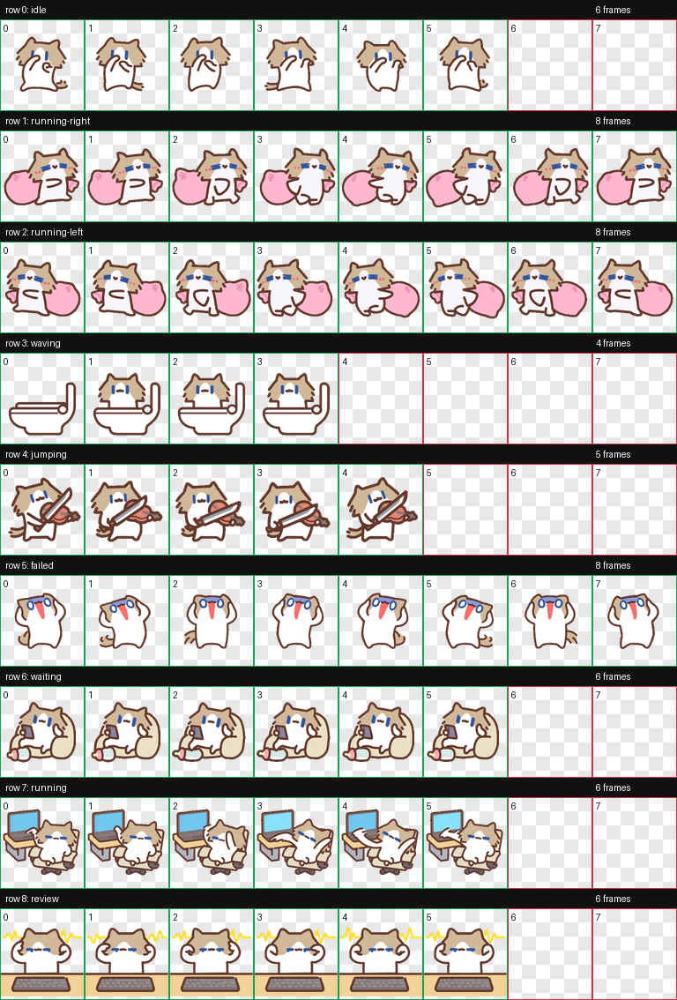

# 月薪喵 · 动画角色实验

记录角色设定、Sprite 迭代与视觉 QA。

[English](README.md) · **简体中文**

   

<a href="#项目概览">项目概览</a> · <a href="#内容导航">内容导航</a> · <a href="#作者与许可">作者与许可</a>

---

> **项目定位** · 角色动画实验

## 项目概览

本目录保存“月薪喵”的 AI 辅助动画制作过程，包括角色设定、动作与方向提示词、参考图、生成记录和质量检查材料。

## 内容导航

- `prompts/base-pet.md`：角色身份、轮廓、配色和生成约束。
- `prompts/rows/`、`prompts/row-retries/`：各状态提示词与迭代记录。
- `references/`：角色参考和布局引导。
- `qa/contact-sheet.png`：检查用接触表；`qa/` 保存审核与配准记录。
- `pet_request.json`、`imagegen-jobs.json`：请求与生成记录。

这是制作材料和流程归档，不是独立桌面宠物程序。阅读无需安装依赖；重新生成可能需要原有服务与环境。保存请求不代表角色当前已经安装或激活。

## 视觉预览

既有制作过程的 QA 接触表；不代表角色当前已安装或激活。

## 作者与许可

作者 / 维护者：[OOOHGOD](https://github.com/OOOHGOD) · 原创贡献：[MIT License](../../../../LICENSE)

允许商用和修改；分发软件副本或实质部分时，须保留版权与许可声明。第三方代码、数据、模型和媒体素材保留各自权利，详见 [许可适用范围](../../../../LICENSE_SCOPE.md)。
