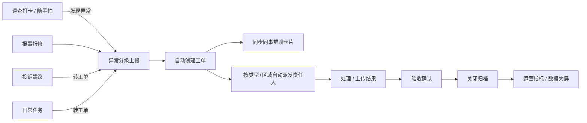

# 智慧园区小程序 PRD · 第一阶段（物业内部）

| 项目 | 内容 |
| --- | --- |
| 文档状态 | 草稿 V0.1 · 待评审 |
| 版本 | V0.1 |
| 更新日期 | 2026-11-10 |
| 编制 / 评审 | 待填 / 待组织评审 |
| 需求输入 | 《小程序需求拟定.md》、需求分析/附件 下原型截图 3 张 |
| 适用阶段 | 第一阶段：物业内部（内部作业线上化） |
| 交付端 | 微信小程序（员工端） + Web 管理后台 / 数据大屏 + 企业微信群机器人 |

> **编写说明**
> 1. 原 PRD 文件为空，本次依据《小程序需求拟定.md》的模块骨架与附件原型，补齐第一阶段完整规格。
> 2. 文中 **【需求原文】** 表示需求拟定中已明确的要求；**【建议】** / **【待确认】** 表示原文只有标题或尚未定义，由本 PRD 给出可评审的提议方案，**不代表已决策**。
> 3. 第 13 章汇总所有待确认项，评审会需逐条闭环后再进入开发。

## 修订记录

| 版本 | 日期 | 修订人 | 说明 |
| --- | --- | --- | --- |
| V0.1 | 2026-11-10 | — | 依据需求拟定从零补齐第一阶段 PRD 草案，含统一工单引擎、7 个业务模块、数据大屏口径、待确认清单 |

---

## 1. 项目背景与目标

### 1.1 背景

园区物业当前的巡查、报修、放行、投诉等作业依赖纸质表单、微信群与口头交接，存在记录分散、责任人不明确、异常处置无闭环、管理层看不到运营数据等问题。需要一个面向**物业内部员工**的小程序，把作业过程线上化，并把现场异常自动转成可追踪、可派发、可统计的工单。

阶段划分【需求原文】：

- **阶段一（物业内部）**：物品放行、随手拍、报事报修、数据大屏、日常任务管理、会议预约、投诉建议 —— **本 PRD 范围**。
- **阶段二（对内园区）**：停车管理等面向园区企业 / 访客的服务能力 —— **本期不做**，但数据模型需预留扩展。

### 1.2 产品目标

1. 建立「发现 → 上报 → 自动建单 → 自动派发 → 处理 → 验收 → 统计」的闭环，替代纸质与群聊口头流程。
2. 巡查过程可配置（打卡时间、打卡路线）、可验证（人员、时间、点位、照片）、异常可分级上报【需求原文】。
3. 一线人员单人单端完成全部高频作业，减少多系统切换。
4. 管理层通过 Web 数据大屏查看园区设备、运营、能耗数据【需求原文】。

### 1.3 成功指标【建议，待确认基线】

| 指标 | 定义 | 目标值 |
| --- | --- | --- |
| 异常自动派单率 | 异常上报后由系统自动派发到责任人的工单占比 | ≥ 90% |
| 异常响应时长 | 异常上报 → 处理人接单的中位时长 | ≤ 10 min（P1 ≤ 5 min） |
| 巡查打卡完成率 | 已执行打卡点 / 计划应打卡点 | ≥ 95% |
| 工单闭环率 | 统计周期内已关闭工单 / 新建工单 | ≥ 90% |
| 放行单线上化率 | 小程序放行单 / 全部放行记录 | 100%（取消纸质单） |
| 大屏数据可用率 | 指标正常出数天数 / 自然日 | ≥ 99% |

### 1.4 本期范围

| 模块 | 本期范围 | 主要端 | 来源 | 优先级 |
| --- | --- | --- | --- | --- |
| 物品放行 | 放行申请、审批、电子放行凭证、门岗核验、归档 | 小程序 + Web | 需求原文（标题）/ 图 2 通行码原型 | P0 |
| 随手拍 | 巡查点位与路线配置、顺序打卡、异常分级上报、自动建单、群聊同步、自动派发 | 小程序 + Web 配置 + 企微群 | 需求原文（详述）/ 图 1 巡检任务原型 | P0 |
| 报事报修 | 突发事件 / 特殊情况登记、转工单、设备关联、确认闭环 | 小程序 + Web | 需求原文 + 图 1 设备详情 / 事件详情 | P0 |
| 数据大屏 | Web 端园区设备、运营、能耗数据看板 | Web | 需求原文 + 图 3 智慧园区平台 | P1 |
| 日常任务管理 | 任务下发、执行反馈、验收、逾期提醒 | 小程序 + Web | 需求原文（标题） | P1 |
| 会议预约 | 会议室档案、时段预约、冲突检测、签到、统计 | 小程序 + Web | 需求原文（标题） | P1 |
| 投诉建议 | 登记、受理、转工单、办结、回访 | 小程序 + Web | 需求原文（标题）/ 图 2 投诉管理原型 | P1 |
| 公共基础 | 登录与组织、权限、统一工单引擎、附件、消息、配置、埋点 | 双端 + 服务端 | 由上述模块推导 | P0 |

### 1.5 明确不做（Out of Scope）

1. 阶段二全部内容：停车管理、面向园区企业 / 租户 / 访客的自助端、访客自助预约、缴费与支付。
2. 能耗采集硬件改造、物联网设备直连控制；本期仅**只读接入**已有平台数据【待确认接口可用性】。
3. 外部人员注册、公开分享链接、对外评价公示。
4. 独立 App、多园区集团化部署（数据模型按单园区设计，保留园区 ID 字段）。

---

## 2. 用户、角色与权限

### 2.1 角色定义【建议】

| 角色 | 典型人员 | 核心诉求 |
| --- | --- | --- |
| 巡查人员 | 保洁、安保、消防巡检员 | 按计划顺序打卡、快速上报异常、查看自己的任务 |
| 上报人 | 物业全员 | 报事报修、投诉建议登记、物品放行申请 |
| 工单处理人 | 工程维修、保洁、安保、客服 | 接单、处理、上传处理结果、申请完工 |
| 部门主管 / 调度员 | 各部门负责人 | 派单兜底、转派、验收、超时催办、查看本部门数据 |
| 放行审批人 | 部门负责人 / 物业经理 | 审批放行申请 |
| 门岗核验人 | 门岗安保 | 扫码核验放行凭证、登记放行结果 |
| 会议室管理员 | 行政 / 客服 | 维护会议室、处理预约冲突 |
| 数据查看者 | 园区经理、管理层 | Web 数据大屏、导出报表 |
| 系统管理员 | 信息化 / 运维 | 组织、角色、字典、计划模板、派单规则、消息模板配置 |

### 2.2 权限矩阵（简化）【建议】

| 模块 | 巡查/上报人 | 处理人 | 主管/调度 | 审批/门岗 | 管理员 | 数据查看者 |
| --- | --- | --- | --- | --- | --- | --- |
| 巡查计划与点位配置 | — | — | 查看 | — | 配置 | 查看 |
| 巡查打卡与异常上报 | 执行 | — | 查看全部 | — | 查看 | 查看 |
| 报事报修 / 投诉登记 | 新建、查自己 | 处理 | 查看全部、办结 | — | 查看 | 查看 |
| 工单接单与处理 | — | 处理 | 转派、验收 | — | 查看 | — |
| 物品放行申请 | 新建、查自己 | — | 查看 | 审批 / 核验 | 查看 | 查看 |
| 会议预约 | 新建、查自己 | — | 查看全部 | 会议室管理 | 配置 | 查看 |
| 日常任务 | 执行自己的 | 执行 | 下发、验收 | — | 配置 | 查看 |
| 数据大屏 | — | — | 本部门维度 | — | 全部 | 全部 |
| 系统配置 | — | — | — | — | 全部 | — |

> 权限实现：RBAC（角色 × 数据范围：本人 / 本部门 / 全园区），服务端强制校验，前端仅做展示控制。**【待确认】** 是否与企业微信组织架构自动同步。

---

## 3. 总体设计

### 3.1 系统构成

```
微信小程序（物业内部员工）
   │  打卡 / 上报 / 审批 / 预约 / 核验 / 我的任务
   ▼
后端服务 ── 统一工单引擎 ── 消息服务 ──→ 企业微信应用消息 + 同事群聊机器人卡片
   │                                      （异常上报自动同步、@责任人）
   ├── Web 管理后台：配置、工单处置、台账、报表、数据大屏
   ├── 文件服务：图片压缩 / 水印 / 鉴权访问
   └── 只读集成：设备台账 / 物联平台 / 能耗系统 ──→ 数据大屏指标
```

### 3.2 核心业务闭环



> 物品放行、会议预约为独立审批/预约流程，不进入工单引擎；其统计数据汇入数据大屏。

### 3.3 功能地图

- **小程序端**：首页（待办 / 快捷入口）｜巡查任务｜随手拍上报｜报事报修｜物品放行｜会议预约｜日常任务｜投诉建议｜我的（工单、记录、消息）
- **Web 管理端**：工作台｜工单中心｜巡查配置｜放行管理｜会议室管理｜任务管理｜投诉管理｜设备台账｜数据大屏｜系统设置
- **服务端能力**：工单引擎、派单规则、状态机、消息通知、附件、审计日志、指标计算

### 3.4 全局通用规则【建议】

| 项 | 规则 |
| --- | --- |
| 登录 | 微信授权 + 手机号绑定 + 组织白名单；仅物业内部人员可进入，无自助注册；未绑定人员引导联系管理员 |
| 组织 | 园区 → 楼栋 → 楼层 → 点位 / 房间 四级空间树，全模块统一引用 |
| 编号 | 工单 `GD-YYYYMMDD-####`、放行 `FX-`、巡查任务 `XJ-`、会议 `HY-`、投诉 `TS-`、日常任务 `RW-`；服务端生成、全局唯一 |
| 时间 | 统一 `YYYY-MM-DD HH:mm:ss`，东八区；列表默认按创建时间倒序 |
| 附件 | 图片最多 9 张 / 单张 ≤ 10 MB，客户端压缩，自动叠加时间 + 地点 + 人员水印；上传失败可重试 |
| 列表 | 分页 20 条，支持按状态 / 时间 / 类型 / 区域筛选与关键字搜索 |
| 幂等 | 打卡、建单、审批、核验接口均需幂等键，防止重复提交 |
| 离线 | 打卡与异常上报支持本地缓存、恢复网络后补传，补传记录标记「离线补传」 |
| 删除 | 仅草稿 / 误报记录可删除，且为软删除；已流转记录只能作废并留痕 |
| 审计 | 关键操作（建单、派单、转派、审批、核验、关闭、配置变更）写操作日志，保留 ≥ 180 天 |

---

## 4. 统一工单引擎（公共能力，P0）

随手拍异常、报事报修、转工单的投诉建议与日常任务、设备详情「转工单」共用同一套工单模型，避免各模块各建一套状态。

### 4.1 工单字段【建议】

| 字段 | 类型 | 必填 | 说明 |
| --- | --- | --- | --- |
| 工单号 / 来源类型 / 来源单号 | 字符串 | 是 | 来源类型：巡查异常、报事报修、投诉、日常任务、设备告警 |
| 标题 / 事件描述 | 字符串 | 是 | 简要事件信息【需求原文】 |
| 事件类型 | 字典 | 是 | 保洁 / 安全 / 消防 / 设施设备 / 服务态度 / 其他，可配置 |
| 紧急程度 | 枚举 | 是 | L1 紧急 / L2 重要 / L3 一般（见 4.3） |
| 空间位置 | 空间树 | 是 | 园区-楼栋-楼层-点位/房间；打卡异常自动带出 |
| 设备关联 | 设备 ID | 否 | 关联设备档案与历史维修记录 |
| 现场照片 | 附件 | 条件必填 | 异常 / 报修类至少 1 张【需求原文：上传现场照片】 |
| 上报人 / 上报时间 | 人员 / 时间 | 是 | 系统自动带出 |
| 责任部门 / 处理人 | 组织 / 人员 | 是 | 由派单规则自动填充 |
| 状态 / 当前节点 | 枚举 | 是 | 见 4.2 |
| 响应时限 / 处理时限 | 时间 | 是 | 按等级由 SLA 计算 |
| 处理说明 / 处理附件 | 文本 / 附件 | 完工必填 | 处理结果留证 |
| 验收人 / 验收结论 / 验收时间 | 人员 / 枚举 / 时间 | 关闭必填 | 主管或上报人确认 |
| 群聊消息 ID | 字符串 | 否 | 用于卡片状态更新，避免重复刷屏 |

### 4.2 状态机

| 状态 | 进入条件 | 允许动作 | 后续状态 |
| --- | --- | --- | --- |
| 待派单 | 异常/事件自动建单，规则未命中 | 手动派单、自动重试派单 | 已派单 |
| 已派单（待接单） | 派单成功 | 接单、转派、退回 | 处理中 / 待派单 |
| 处理中 | 处理人接单 | 上传进展、申请完工、挂起 | 待验收 / 已挂起 |
| 已挂起 | 缺料 / 需外部协同 | 恢复、关闭 | 处理中 / 已关闭 |
| 待验收 | 处理人提交完工 | 验收通过、验收驳回 | 已关闭 / 处理中 |
| 已关闭 | 验收通过 | 查看、导出 | — |
| 已作废 | 误报 / 重复单 | 查看 | — |

每次流转写一条流转日志（操作人、时间、前后状态、备注），并同步更新群聊卡片状态与处理人待办。

### 4.3 异常分级与 SLA【建议】

需求原文要求「异常发生分等级上报」，等级定义与通知对象建议如下：

| 等级 | 判定示例 | 通知对象 | 响应 / 处理时限 | 超时升级 |
| --- | --- | --- | --- | --- |
| L1 紧急 | 消防警情、漏电、漏水、电梯困人、人员受伤、重大安全隐患 | 处理人 + 部门主管 + 园区经理 + 群聊 @所有人 | 5 min / 2 h | 15 min 未接单 → 主管；1 h 未处理 → 园区经理 |
| L2 重要 | 公共区域设施损坏、照明异常、影响通行/办公的保洁问题 | 处理人 + 部门主管 + 群聊 | 10 min / 8 h | 30 min 未接单 → 主管 |
| L3 一般 | 轻微保洁、零星修缮、非紧急建议 | 处理人 | 30 min / 24 h | 4 h 未接单 → 主管 |

> 上报时默认 L3，用户可上调；L1 需二次确认弹窗，且强制至少 1 张现场照片。**【待确认】** 等级是否允许下调、是否需主管复核。

### 4.4 自动派单规则【需求原文：工单自动派发到对应部门人员处理】

1. 匹配优先级：`事件类型 × 空间区域` 精确规则 → `事件类型` 默认部门规则 → 部门调度池 → 系统管理员告警。
2. 部门内分单策略可配置：指定责任人 / 轮询 / 按当前在岗与在手工单数负载均衡【建议默认轮询】。
3. 派单成功后：写工单、生成处理人待办、推送企业微信应用消息、在**同事群聊**发送卡片并 @责任人。
4. 派单失败或超时未接单：自动转调度池并通知主管，工单不丢失。
5. 支持主管手动转派，转派留痕且不计入自动派单率。

### 4.5 同事群聊同步【需求原文：自动形成工单同步到同事群聊】

| 项 | 规则【建议】 |
| --- | --- |
| 通道 | 企业微信群机器人 Webhook（群按园区 / 部门配置）；同时发应用消息给责任人 |
| 卡片内容 | 工单号、等级、事件类型、位置、简要描述、上报人、缩略图 1 张、责任人、状态、跳转小程序按钮 |
| 状态同步 | 接单 / 完工 / 关闭时更新同一条卡片（若机器人不支持更新，则合并为一条「进度汇总」，避免刷屏） |
| 降噪 | 同点位同类型 30 分钟内重复上报合并为同一工单的附属记录，不重复发卡片 |
| 兜底 | 机器人发送失败重试 3 次，失败写告警日志并在 Web 工作台提示 |

---

## 5. 模块详细需求

### 5.1 物品放行（放行表单）

> 需求拟定仅给出标题，以下为建议方案；UI 参考图 2「通行码」原型。

**场景**：物品 / 设备搬出园区，需线上申请、审批通过后生成电子放行凭证，门岗扫码核验后放行，全程留痕可查。

**角色**：申请人（物业内部经办）→ 审批人 → 门岗核验人 → 归档查询。

**流程**

```
新建放行单（草稿）→ 提交 → 审批通过 / 驳回
  → 通过后生成放行二维码（含有效期）→ 门岗扫码核验
  → 核验通过：登记核验人/时间/照片，放行单置「已放行」
  → 过期未核验 / 申请人撤销 → 「已过期 / 已作废」
```

**字段表**

| 字段 | 类型 | 必填 | 说明 |
| --- | --- | --- | --- |
| 放行单号 / 状态 | 字符串 / 枚举 | 自动 | 草稿、待审批、待放行、已放行、已驳回、已作废、已过期 |
| 申请人 / 所属部门 / 联系电话 | 人员 / 组织 / 手机号 | 是 | 登录自动带出，电话可改 |
| 物品名称 / 类别 / 数量 / 估值 | 文本 / 字典 / 数字 | 是 | 支持多条明细行 |
| 携带人 / 携带来访单位 | 文本 | 是 | 图 2 原型中「邀访人单位名称」字段可复用 |
| 访客车牌 / 访客成员 | 文本 | 否 | 与图 2 原型一致；车辆信息多车牌用逗号分隔 |
| 放行原因 / 备注 | 文本 | 是 | — |
| 计划出区时间 / 放行口 | 时间 / 字典 | 是 | 门岗核验时按放行口筛选待放行单 |
| 物品照片 / 附件 | 图片 | 是 | 至少 1 张，贵重物品可要求多角度 |
| 审批人 / 审批意见 / 审批时间 | 人员 / 文本 / 时间 | 自动 | 支持驳回填写原因 |
| 放行二维码 / 有效期 | 二维码 / 时间 | 自动 | 默认 24 h，可配置【待确认】 |
| 核验人 / 核验时间 / 核验照片 | 人员 / 时间 / 图片 | 放行必填 | 门岗端记录 |

**规则**

1. 一单一码，二维码绑定单号且服务端校验签名，禁止截图转发复用；核销后立即失效。
2. 审批层级【待确认】：建议按估值分一级 / 二级审批（如 > 5000 元需物业经理复核），阈值可配置。
3. 有效期过期自动置「已过期」，门岗不得核验；过期可重新申请（复制原单）。
4. 门岗核验列表仅展示「待放行且在有效期内且属于本放行口」的单据。
5. 全部状态变更写日志，支持按时间 / 部门 / 物品 / 携带人检索与导出。

**验收要点**：提交→审批→生成码→扫码核验→状态闭环全链路可跑通；过期码、重复核验、越权审批均被拦截；纸质单可完全替代。

---

### 5.2 随手拍（保洁、安全、消防等巡查）★ 核心模块

> 【需求原文】根据园区设定的楼层打卡点进行顺序打卡；可设定打卡时间和打卡路线；记录打卡人员、打卡时间、是否出现异常；异常发生分等级上报；上传现场照片和简要事件信息；异常上报自动形成工单同步到同事群聊；工单自动派发到对应部门人员处理。
> UI 参考图 1「巡检任务」：任务列表 / 我的任务、全部巡查筛选、状态（未开始 / 待执行 / 执行中 / 已执行）、巡检人员、计划起止时间。

#### 5.2.1 巡查配置（Web 管理端）

| 配置项 | 说明 |
| --- | --- |
| 空间与打卡点 | 园区 → 楼栋 → 楼层 → 点位；点位含名称、编号、位置描述、二维码 / NFC 标签 / GPS 坐标、绑定设备（可选） |
| 打卡路线 | 由若干点位按**顺序**组成，支持多条路线（保洁、安全、消防各自独立） |
| 巡查计划 | 计划名称、路线、频次（每日 / 每周指定日 / 按班次）、计划起止时间、允许偏差时间窗、巡检人员（单人 / 多人 / 轮班）、生效日期区间 |
| 打卡要求 | 是否必须拍照、是否需要定位校验、允许的最大定位偏差（建议 50 m）、是否允许离线补传 |
| 异常类型字典 | 保洁 / 安全 / 消防 / 设施设备 / 其他，下挂子类型，用于自动派单 |
| 通知配置 | 对应群聊机器人、@规则、超时提醒阈值 |

#### 5.2.2 打卡执行（小程序）

1. **任务列表**：「任务列表 / 我的任务」双 Tab，按状态（未开始 / 待执行 / 执行中 / 已执行）、日期、路线筛选；展示巡检人员与计划起止时间（对齐图 1 原型）。
2. **进入任务**：展示路线点位清单、当前应打卡点位、进度（3/12）、计划时间窗与剩余时间。
3. **顺序打卡**：必须按路线顺序逐点打卡，**禁止跳点**；未打卡上一点位时，下一点位扫码提示「请先完成前置点位」。
4. **打卡动作**：扫码 / NFC / 定位三选一或组合【待确认】，提交后服务端记录：打卡人员、打卡时间、点位、定位偏差、现场照片、是否正常。
5. **漏打卡与补卡**：超过时间窗未打卡标记「漏卡」，提醒巡检人与主管；补卡需填写原因并由主管审批，补卡记录单独标记。
6. **防作弊【建议，待确认强度】**：照片现场拍摄（限制相册）、水印（时间 + 点位 + 人员）、定位偏差校验、同设备短时多点打卡预警。

#### 5.2.3 异常上报

在任一打卡点位可提交「异常」，也可在任务结束后单独发起「随手拍」。

| 字段 | 必填 | 说明 |
| --- | --- | --- |
| 异常类型 / 子类型 | 是 | 决定责任部门与派单规则 |
| 等级 L1/L2/L3 | 是 | 分级规则见 4.3，L1 需二次确认 |
| 简要事件信息 | 是 | ≤ 200 字【需求原文】 |
| 现场照片 | 是 | ≥ 1 张，最多 9 张，带水印【需求原文】 |
| 是否异常 / 位置 / 上报人 / 时间 | 自动 | 位置由当前点位带出，可手动修正 |
| 关联设备 | 否 | 扫码设备二维码带出设备档案 |

#### 5.2.4 上报后的自动链路【需求原文，由第 4 章承载】

```
提交异常 → 生成异常记录（关联巡查任务/点位）
        → 自动创建工单（来源类型=巡查异常，继承类型/等级/位置/照片/上报人）
        → 群聊机器人推送卡片 + @责任人
        → 派单规则自动派发到对应部门人员
        → 处理人接单/处理/完工 → 主管或上报人验收 → 关闭
        → 结果回写巡查记录，异常点位标记「已闭环」
```

#### 5.2.5 统计与边界

- 个人 / 部门维度：应打卡点、已打卡点、完成率、准点率、漏卡数、异常上报数、平均闭环时长。
- 异常按类型 / 等级 / 区域 / 部门分布，供数据大屏取数。
- 边界：路线点位停用 / 新增时，进行中的任务按快照执行；计划顺延、临时改派、跨班次交接；无网络时打卡与上报本地缓存并补传；重复提交幂等去重。

**验收要点**：可按配置生成计划与路线；顺序打卡与跳点拦截生效；L1 异常 5 分钟内自动建单 + 群卡片 + 派发到指定部门人员；离线补传不丢数据；异常工单闭环后巡查记录同步更新。

---

### 5.3 报事报修（突发事件、特殊情况等工单生成）

> 【需求原文】突发事件、特殊情况等工单生成。UI 参考图 1「设备详情」「事件详情」、图 2「事件详情」。

**两条入口**

1. **直接报修**：填写信息 → 提交即生成工单（适用于明确需处理的事件）。
2. **事件登记 → 转工单**：先登记事件记录，查看详情后可「转工单 / 确认 / 删除」（对齐图 1、图 2 原型底部按钮），适用于需先判定的特殊情况。

**字段表**

| 字段 | 必填 | 来源 / 说明 |
| --- | --- | --- |
| 事件名称 | 是 | 图 1 / 图 2 原型 |
| 事件状态 | 自动 | 待处理 → 已转工单 → 处理中 → 待确认 → 已确认 / 已关闭 / 已作废 |
| 紧急程度 | 是 | 重要 / 一般等，映射工单 L1–L3 |
| 上报人员 / 联系电话 | 是 | 登录带出，电话可改（图 2 原型含联系电话） |
| 事件地点 | 是 | 空间树选择，如「公共区域-园区地下-地下三层机房」 |
| 上报时间 | 自动 | 服务端时间 |
| 事件信息 | 是 | 事件描述 |
| 图片附件 | 否 | 建议至少 1 张 |
| 关联设备 | 否 | 扫设备二维码带出 |

**设备详情联动（图 1 原型）**：设备名称、设备状态（在线）、设备类型、系统分类（变配电系统等）、「维修记录 / 告警记录」Tab；维修记录含维修人员、维修时间、维修内容、附件。工单完工后自动回写该设备的维修记录，形成设备档案时间线。

**规则**

1. 「确认」用于上报人 / 主管对事件记录核实；「删除」仅允许待处理且未转工单的记录，软删除留痕。
2. 转工单时字段继承，不重复录入；一张事件记录只能转一张工单。
3. 同地点 + 同事件类型 + 30 分钟内重复上报提示合并，避免重复派单。
4. 误报可标记「已作废」，不计入工单闭环率分母。

**验收要点**：两条入口均可生成可追踪工单；设备档案与维修记录双向可查；合并提示与误报作废生效。

---

### 5.4 日常任务管理

> 需求拟定仅给出标题，以下为建议方案。**【待确认】** 是否复用统一工单引擎（建议：轻量任务独立模型，可一键转工单）。

| 项 | 规则【建议】 |
| --- | --- |
| 任务类型 | 计划任务（按日/周/月模板自动生成）、临时任务（手工下发） |
| 字段 | 任务号、标题、描述、任务类型、指派人/部门、协作人、优先级、开始与截止时间、附件、验收人、验收标准、关联空间/设备 |
| 状态 | 待领取 → 进行中 → 待验收 → 已完成；另有 已逾期 / 已取消 / 已转工单 |
| 执行 | 执行人可分批反馈进度、上传完成照片；支持一次「转工单」把需跨部门处理的任务交给工单引擎 |
| 提醒 | 截止前 N 小时提醒、逾期每日提醒执行人与下发人，可配置 |
| 验收 | 验收人通过 / 驳回，驳回需填写原因并退回进行中 |
| 统计 | 按时完成率、逾期率、按部门/人员任务量，汇入数据大屏 |

**与巡查任务的边界**：巡查任务 = 固定点位 + 固定顺序 + 打卡留痕；日常任务 = 无点位要求的通用待办。两者在数据大屏分别统计。

---

### 5.5 会议预约

> 需求拟定仅给出标题，以下为建议方案。

| 项 | 规则【建议】 |
| --- | --- |
| 会议室档案（Web 配置） | 名称、所属楼栋/楼层、容量、配套设备（投影/视频会议/白板）、照片、可用时段、是否需审批、维护状态 |
| 预约（小程序） | 日期 + 时段选择、会议主题、参会人数、参会人（内部选择）、备注；可用时段以日历/时间轴展示，已占用时段置灰 |
| 冲突检测 | 提交时服务端二次校验，同一会议室同一时段仅一条有效预约；并发以锁/唯一约束保证 |
| 审批 | 默认免审批；需审批的会议室走一级审批【待确认】 |
| 变更 | 允许提前取消 / 修改；开始后不可修改，可提前结束并释放 |
| 签到 | 生成会议二维码，开始前后 15 分钟内签到；超时未签到自动释放并标记「未使用」，计入爽约统计【待确认】 |
| 提醒 | 会前 15 min 推送企业微信消息给预约人与参会人 |
| 状态 | 待使用 → 使用中 → 已结束；另有 已取消 / 未使用 / 审批中 |
| 统计 | 会议室使用率、时段热度、爽约率、部门占用分布，汇入数据大屏 |

---

### 5.6 投诉建议

> 需求拟定仅给出标题；UI 参考图 2「投诉管理」：投诉列表 / 我的投诉、按事件名称搜索、状态「待受理 / 工单已结 / 已结案」、操作「转工单 / 编辑 / 删除 / 办结」、字段「投诉人、投诉时间、投诉内容」、分类示例「服务态度不好」。

**范围界定【待确认】**：阶段一为物业内部，**建议**仅支持客服 / 物业人员代录来自园区企业、租户、访客的投诉，不开放外部自助提交；阶段二再开放对外入口。

**字段表**

| 字段 | 必填 | 说明 |
| --- | --- | --- |
| 投诉单号 / 状态 | 自动 | 待受理、已受理、已转工单、处理中、待办结、已办结、已驳回 |
| 投诉人 / 联系电话 | 是 | 代录时填写 |
| 投诉类型 | 是 | 服务态度 / 环境卫生 / 设施设备 / 安全管理 / 其他（可配置字典） |
| 投诉对象 / 涉及区域 | 否 | 便于定责与统计 |
| 投诉内容 | 是 | 文本 + 图片附件 |
| 来源渠道 | 是 | 电话 / 现场 / 微信群 / 企业微信 / 其他 |
| 紧急程度 / 受理人 / 受理时间 | 自动或选择 | — |
| 处理说明 / 办结结论 | 办结必填 | — |
| 回访结果 / 满意度 | 否 | 建议对已办结投诉抽样回访【待确认】 |

**流程与规则**

1. 登记 → 受理（指定受理人）→ 可「转工单」进入统一工单引擎（复用第 4 章派单与闭环）→ 处理 → 「办结」→ 归档。
2. 未转工单的简单投诉可由受理人直接办结，需填写处理说明，不允许空结论。
3. 「编辑」仅待受理状态可改；「删除」仅限误录，软删除留痕；已办结记录只读。
4. 投诉人与投诉内容对非受理角色脱敏展示；导出需权限。
5. 统计：投诉量、按类型分布、平均办结时长、重复投诉对象 Top N，汇入数据大屏。

---

### 5.7 数据大屏（Web 端）

> 【需求原文】园区通过 Web 端查看园区各项运营数据，包括设备数据、园区运营数据、能耗数据等。
> UI 参考图 3「智慧园区管理平台」：顶部「基础管理平台 / 运营管理平台 / 物联网平台」，左侧菜单「园区管理、空间管理、统一授权、用户管理、部门管理、系统管理、菜单管理、消息模板、操作日志、接口管理、埋点分析」，园区基本信息卡片（园区名称、面积类指标、楼栋/房间数、地址、法人等）与园区实景图；右侧可见排名条形图与工单状态统计卡片。

**定位**：只读看板，不做小程序端；指标数据源为本期业务库 + 只读接入的设备 / 物联 / 能耗系统。**【待确认】** 是否复用已有智慧园区管理平台的菜单与权限体系（建议复用，避免两套后台）。

#### 5.7.1 看板分区【建议】

| 分区 | 主要指标 | 数据来源 |
| --- | --- | --- |
| A 园区概览 | 占地面积、建筑面积、楼栋数、房间数、入驻企业数、园区实景图、园区基本信息 | 基础资料（园区档案） |
| B 设备数据 | 设备总数、在线数 / 在线率、告警数、按系统分类分布（变配电、给排水、暖通、电梯、照明…）、近期维修记录 | 设备台账 / 物联平台只读接口 |
| C 园区运营数据 | 今日/本期工单总量、按状态分布、闭环率、平均响应与处理时长、按事件类型/区域分布；巡查计划执行率、打卡完成率、异常上报数；投诉量与办结率；会议预约使用率；放行单数 | 本期业务库（工单、巡查、投诉、会议、放行） |
| D 能耗数据 | 水 / 电 / 气日与月用量、同比环比、单位面积能耗强度、能耗异常 Top N 楼栋 | 能耗系统只读接口 |
| E 实时动态 | 实时告警与新事件滚动列表、L1 异常醒目提示、部门处理时效排名（对齐图 3 排名条形图） | 工单引擎 / 消息服务 |

#### 5.7.2 指标口径表（示例，评审时需与数据提供方逐项确认）

| 指标 | 定义 / 公式 | 数据源 | 刷新频率 |
| --- | --- | --- | --- |
| 工单闭环率 | 周期内已关闭工单数 ÷ 周期内新建工单数 | 工单库 | 5 min |
| 平均响应时长 | ∑(接单时间 − 建单时间) ÷ 已接单工单数 | 工单流转日志 | 5 min |
| 平均处理时长 | ∑(关闭时间 − 接单时间) ÷ 已关闭工单数 | 工单流转日志 | 5 min |
| 巡查打卡完成率 | 已打卡点数 ÷ 计划应打卡点数 | 打卡记录 | 5 min |
| 设备在线率 | 在线设备数 ÷ 台账设备总数 | 物联平台 | 15 min【待确认】 |
| 单位面积能耗 | 当期电/水/气折算量 ÷ 建筑面积 | 能耗系统 + 园区档案 | T+1 |
| 会议室使用率 | 实际占用时长 ÷ 可用时长 | 预约记录 | T+1 |

#### 5.7.3 交互与权限

- 筛选：时间范围（今日 / 本周 / 本月 / 自定义）、园区 / 楼栋 / 部门下钻；点击指标可下钻到对应记录列表。
- 展示：大屏分辨率适配、自动轮播、异常指标高亮；支持导出 PDF / Excel（需权限）。
- 权限：管理层看全园区，部门主管仅看本部门维度，处理人不可见大屏。
- 降级：外部数据源不可用时显示「数据暂不可用 + 最后更新时间」，缓存上一次成功结果，不得展示 0 值误导。

---

### 5.8 管理端基础配置（Web）

对齐图 3 左侧菜单能力，本期需具备：组织与用户、部门、角色权限（统一授权）、空间与打卡点、菜单与字典、消息模板（群卡片 / 应用消息文案）、操作日志、接口管理（外部数据源登记）、埋点分析；以及业务配置：巡查计划模板、异常类型与部门映射、等级 SLA、派单规则、放行审批阈值、会议室档案、设备台账。

---

## 6. 主要数据实体【建议】

| 实体 | 关键字段 | 备注 |
| --- | --- | --- |
| 组织 / 人员 / 角色 | 人员 ID、姓名、手机号、部门、角色、状态、企微 UserID | 白名单控制登录 |
| 空间 / 点位 / 路线 | 园区-楼栋-楼层-点位 ID、二维码/NFC/GPS、路线点位顺序 | 巡查与事件共用 |
| 巡查计划 / 任务 / 打卡记录 | 计划 ID、路线、时间窗、巡检人；任务状态；打卡人/时间/点位/照片/是否正常 | 图 1 原型字段 |
| 异常记录 | 类型、等级、描述、照片、位置、上报人、关联工单号 | 随手拍 |
| 工单 / 流转日志 | 见 4.1；日志含前后状态与操作人 | 统一引擎 |
| 放行单 / 核验记录 | 见 5.1 | 含二维码有效期 |
| 事件 / 报修记录 | 见 5.3 | 可关联设备 |
| 设备 / 维修记录 | 设备名称、状态、类型、系统分类、维修人员/时间/内容/附件 | 图 1 原型 |
| 会议预约 / 会议室 | 见 5.5 | 唯一时段约束 |
| 投诉建议 / 日常任务 | 见 5.6 / 5.4 | 均可转工单 |
| 消息通知 / 群卡片 | 通道、接收人、模板、发送状态、关联业务单号 | 失败重试 |
| 附件 / 操作日志 / 指标快照 | 存储键、水印信息；操作留痕；大屏预计算 | 审计与性能 |

> 所有实体含 `园区ID`、`创建人/时间`、`更新人/时间`、`是否删除`，为阶段二多园区与租户端预留扩展。

---

## 7. 接口与集成【建议，待确认】

| 集成方 | 方向 | 用途 | 关键依赖 |
| --- | --- | --- | --- |
| 微信 / 小程序 | 入 | 授权登录、手机号、订阅消息、扫码 | 小程序账号与类目资质 |
| 企业微信 | 双向 | 组织与人员同步、应用消息推送、群机器人卡片、审批（可选） | **需明确「同事群聊」是企微群还是微信群**；微信群无官方机器人能力 |
| 物联 / 设备平台 | 只读 | 设备台账、在线状态、告警 | 接口文档、鉴权、字段与频率 |
| 能耗系统 | 只读 | 水/电/气用量 | 计量口径、T+1 或实时 |
| 对象存储 | 双向 | 图片上传、压缩、水印、鉴权 URL | 容量与生命周期 |
| Web 大屏 | 出 | 指标查询、下钻、导出 | 指标口径确认 |

**接口通用约定**：HTTPS、统一鉴权、幂等键、分页与错误码规范、超时重试、敏感字段脱敏、调用日志。

---

## 8. 非功能需求【建议】

| 类别 | 要求 |
| --- | --- |
| 性能 | 小程序首屏 ≤ 2 s；打卡 / 上报提交响应 ≤ 1 s（P95）；大屏首屏 ≤ 3 s；支持 ≥ 200 人同时在线、打卡高峰 50 QPS |
| 兼容 | 微信主流版本；Web 端 Chrome / Edge 最近两个大版本；移动端适配 375–430 px 宽度 |
| 可靠性 | 离线缓存与补传、上传断点续传、接口幂等、派单失败兜底；核心链路可用性 ≥ 99.5% |
| 安全 | 最小权限 + 服务端校验、越权访问拦截、图片鉴权 URL（防盗链）、传输加密、日志留存 ≥ 180 天、敏感信息脱敏（手机号、投诉人） |
| 隐私 | 仅收集作业必需信息；定位与照片仅用于业务留证，明确告知一线人员；不对外共享 |
| 可配置 | 等级 SLA、派单规则、消息模板、字典、审批阈值均可后台配置，不发版生效 |
| 可观测 | 关键链路埋点、失败告警、大屏数据异常告警 |

---

## 9. 埋点与验收

### 9.1 关键埋点

| 事件 | 触发时机 | 关键参数 |
| --- | --- | --- |
| `patrol_checkin` | 打卡提交成功 | 任务 ID、点位 ID、是否离线补传、耗时 |
| `issue_report` | 异常 / 报修 / 投诉上报成功 | 来源、类型、等级、照片数、是否合并 |
| `workorder_created / assigned / accepted / closed` | 工单各流转节点 | 工单号、来源、等级、部门、耗时 |
| `group_card_sent` | 群聊卡片发送 | 工单号、成功/失败、重试次数 |
| `release_verify` | 门岗核验 | 放行单号、结果、放行口 |
| `meeting_book / meeting_checkin` | 预约 / 签到 | 会议室、时段、是否冲突 |
| `dashboard_view` | 大屏访问 | 角色、分区、筛选条件 |

### 9.2 验收方式

1. 按模块逐个走通第 5 章「验收要点」，形成测试用例清单（正常流 + 边界流 + 权限越权 + 离线 + 重复提交）。
2. 端到端联调：L1 异常上报 → 5 min 内自动建单 → 群卡片 → 自动派发指定部门人员 → 处理 → 验收关闭 → 大屏指标更新。
3. 指标验收：以 1.3 成功指标为上线观察项，试运行 2 周后复盘基线【待确认试运行周期】。

---

## 10. 里程碑建议【待确认】

| 迭代 | 内容 | 说明 |
| --- | --- | --- |
| 迭代 1 | 公共基础（登录/组织/权限/附件/消息）+ 统一工单引擎 + 随手拍 + 报事报修 | 先跑通核心闭环，需求原文最完整的两块 |
| 迭代 2 | 物品放行 + 会议预约 + 日常任务 + 投诉建议 + Web 工单中心 | 复用迭代 1 的工单引擎与组件 |
| 迭代 3 | 数据大屏 + 指标口径联调 + 外部数据源接入 + 试运行与验收 | 依赖设备/能耗接口就绪 |

---

## 11. 风险与依赖

| 风险 | 影响 | 应对 |
| --- | --- | --- |
| 「同事群聊」通道不确定 | 自动同步能力可能无法实现 | 优先确认是否企业微信群；若为微信群，改为企微应用消息 + Web 工作台提醒，并同步产品预期 |
| 设备 / 能耗系统接口未就绪 | 数据大屏 B、D 分区无法出数 | 先以台账导入 + 手工录入兜底，接口就绪后切换；大屏显示数据状态标识 |
| 巡查点位与路线基础数据缺失 | 随手拍无法上线 | 将点位测绘、二维码贴装列为上线前置任务 |
| 需求拟定中 5 个模块仅有标题 | 范围与验收口径不清 | 第 13 章待确认项评审闭环后再排期 |
| 一线人员操作成本 | 抵触使用、数据失真 | 打卡 ≤ 3 步、异常上报 ≤ 5 步，支持离线与补传 |

---

## 12. 需求追溯矩阵

| 需求拟定条目 | 本 PRD 章节 | 状态 |
| --- | --- | --- |
| 阶段一（物业内部）范围 | 1.1 / 1.4 | 已展开 |
| 物品放行（放行表单） | 5.1 | 原文仅标题，方案待确认 |
| 随手拍：楼层点位顺序打卡 | 5.2.1 / 5.2.2 | 已展开 |
| 可设定打卡时间和打卡路线 | 5.2.1 | 已展开 |
| 记录打卡人员、打卡时间、是否异常 | 5.2.2 / 5.2.3 | 已展开 |
| 异常分级上报 | 4.3 / 5.2.3 | 等级定义待确认 |
| 上传现场照片和简要事件信息 | 3.4 / 5.2.3 | 已展开 |
| 异常上报自动形成工单同步到同事群聊 | 4.5 / 5.2.4 | 通道待确认 |
| 工单自动派发到对应部门人员 | 4.4 / 5.2.4 | 规则待确认 |
| 报事报修（突发事件、特殊情况工单生成） | 5.3 | 已展开 |
| 数据大屏（设备 / 运营 / 能耗，Web 端） | 5.7 | 数据源待确认 |
| 日常任务管理 | 5.4 | 原文仅标题，方案待确认 |
| 会议预约 | 5.5 | 原文仅标题，方案待确认 |
| 投诉建议 | 5.6 | 原文仅标题，方案待确认 |
| 阶段二（对内园区）停车管理 | 1.5 | 本期不做，仅预留模型 |

---

## 13. 待确认问题清单（评审会逐条闭环）

| # | 问题 | 影响章节 | 建议默认 |
| --- | --- | --- | --- |
| 1 | 「同事群聊」是企业微信群还是微信群？是否已有群机器人权限？ | 4.5 | 企业微信群机器人 + 应用消息 |
| 2 | 登录走企业微信授权还是微信手机号白名单？组织是否自动同步？ | 2.2 / 3.4 | 企微授权 + 组织同步 |
| 3 | 园区/楼栋/楼层/点位基础数据由谁提供？二维码/NFC 标签是否已贴装？ | 5.2.1 | 上线前置任务 |
| 4 | 打卡验证方式：扫码 / NFC / GPS 还是组合？是否需要防作弊及强度？ | 5.2.2 | 扫码为主 + GPS 辅助 + 照片水印 |
| 5 | 异常等级的判定标准、是否允许下调、L1 是否需主管复核？ | 4.3 | 三级制，L1 二次确认 |
| 6 | 各级 SLA 时限与超时升级对象？ | 4.3 | 按文中建议值，可配置 |
| 7 | 自动派单规则：按类型、区域还是班组？部门内轮询还是指定人？ | 4.4 | 类型 × 区域 → 部门 → 轮询 |
| 8 | 群聊卡片是否需要状态更新，还是每次流转都发新消息？ | 4.5 | 合并进度，避免刷屏 |
| 9 | 物品放行是否需要二级审批？估值阈值、二维码有效期、是否按金额分级？ | 5.1 | 默认一级审批、有效期 24 h |
| 10 | 放行申请主体是否包含园区企业/租户经办人（阶段二能力提前？）？ | 5.1 / 1.5 | 阶段一仅物业内部代录 |
| 11 | 报事报修是否必须「先登记再转工单」，还是允许直接建单？ | 5.3 | 两条入口并存 |
| 12 | 设备台账与物联平台接口是否可在本期提供？字段、频率、鉴权？ | 5.7 / 7 | 先台账导入兜底 |
| 13 | 能耗系统数据粒度（楼栋/楼层/分项）、刷新频率、计量口径？ | 5.7.2 | T+1，按楼栋 |
| 14 | 数据大屏是否复用已有「智慧园区管理平台」的菜单与权限？大屏分辨率？ | 5.7 | 复用后台，独立大屏页 |
| 15 | 日常任务是否与工单合并为一套模型？是否需要任务模板与周期性生成？ | 5.4 | 独立模型 + 一键转工单 |
| 16 | 会议预约是否需要审批、签到、与外部日历同步？爽约释放规则？ | 5.5 | 免审批 + 二维码签到 |
| 17 | 投诉建议阶段一是否开放外部自助提交？是否需要满意度回访？ | 5.6 | 仅内部代录，抽样回访 |
| 18 | 试运行周期、上线成功指标基线（1.3 目标值是否合理）？ | 1.3 / 9.2 | 试运行 2 周 |
| 19 | 迭代排期与人力、是否分三次迭代交付？ | 10 | 按文中建议 |
| 20 | 是否需要多园区 / 集团化扩展、数据保留年限与导出合规要求？ | 6 / 8 | 单园区，日志 ≥ 180 天 |

---

## 附录 A 原型截图索引

| 图 | 文件 | 内容 | 对应模块 |
| --- | --- | --- | --- |
| 图 1 | `Pasted image 20261013155751.png` | 设备详情（设备名称/状态/类型/系统分类、维修记录与告警记录 Tab、维修人员/时间/内容/附件）；事件详情（事件信息字段 + 图片附件 + 转工单/确认/删除）；巡检任务（任务列表/我的任务、全部巡查、已执行/待执行/执行中/未开始、巡检人员、计划起止时间） | 5.3、4.1、5.2 |
| 图 2 | `Pasted image 20261013155850.png` | 事件详情（含联系电话、事件地点）；投诉管理（投诉列表/我的投诉、待受理/工单已结/已结案、转工单/编辑/删除/办结、投诉人/时间/内容）；通行码（通行码/就餐码切换、二维码与有效期、邀访人单位名称、访客类型、访客成员、访客车牌、拜访时间、审批状态） | 5.3、5.6、5.1 |
| 图 3 | `Pasted image 20261013160027.png` | 智慧园区管理平台 Web 端：基础/运营/物联网三平台；园区管理、空间管理、统一授权、用户/部门/系统/菜单管理、消息模板、操作日志、接口管理、埋点分析；园区基本信息与实景图；右侧排名条形图与工单统计卡片 | 5.7、5.8 |

**图 1 · 报事报修与巡检任务参考原型**


**图 2 · 投诉管理与通行码参考原型**


**图 3 · 智慧园区管理平台（数据大屏 / 后台参考）**


## 附录 B 名词表

| 名词 | 说明 |
| --- | --- |
| 随手拍 | 巡查过程中发现保洁、安全、消防、设施等异常时的拍照上报动作，本期与巡查打卡绑定 |
| 打卡点 / 路线 | 楼层等物理位置的点位，及其按巡检顺序组成的有序集合 |
| 工单 | 统一的可追踪处理单，来源含巡查异常、报事报修、投诉、日常任务、设备告警 |
| 自动派单 | 依据事件类型 × 空间区域规则，把工单指派到责任部门与具体处理人 |
| 同事群聊 | 物业内部用于同步异常工单的群，通道形式待确认（见 13-1） |
| 放行凭证 | 审批通过后生成的电子二维码，门岗扫码核销后物品方可出区 |
| 数据大屏 | Web 端只读看板，展示设备、运营、能耗三类园区数据 |
