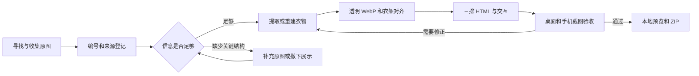

图片寻找、透明挂拍处理与 HTML 展示工作流
整理日期 2026-11-19

适用于本项目的三排挂衣组件。一次完整交付依次经过找图、建档、判断完整度、制作透明挂拍、调整衣架、配置 HTML、浏览器截图验收和打包。



**一、确定展示需要什么图片，再寻找素材**

开始前先明确展示方式。本项目从正面呈现独立挂衣，需要看清领口、肩线、两侧袖型、腰线、衣摆和整件衣物的比例。先按这些部位检查原图，再决定是否选用。

寻找图片时，先检索用户指定目录和已有 `_INDEX.md`，随后核对新增文件。需要补图时，优先找同款的正面全长、平铺或挂拍。供应商提供的原图、产品正面图和同款细节图都可以作为输入。

| 检查内容 | 具体操作 | 本项目例子 |
| --- | --- | --- |
| 款式一致 | 对照领口、印花、袖型和纽扣位置确认同款 | 新增三张白色长袖分别作为 31–33 号 |
| 主体完整 | 检查衣摆和两袖有没有出框，腰部有没有被其他衣物盖住 | 29 号裙摆出框，已撤下展示 |
| 遮挡程度 | 查看头发、手、包带、裤腰遮住了哪些面料和结构 | 31 号蓝色腰间系物遮住下半部 |
| 原图清晰度 | 放大到实际展示尺寸，观察印花边界和面料纹理 | 原图尺寸写入素材索引 |
| 可追溯信息 | 记录来图文件名，已有来源时记录页面地址或原 CDN ID | 29–33 保留来图名称对照 |

本次素材由本地目录和用户追加图片提供。索引中的原 CDN ID 来自既有素材记录。

本地输入目录为
```text
C:\Users\DC\Documents\WXWork\1688855013977120\WeDrive\佛山金颂企业\数智化办公\网站建设\网站建设素材\使用素材\衣服
```

**二、编号、去重和登记**

逐张检查可打开性、像素尺寸和内容。通过文件哈希识别内容完全相同的重复图，随后对照款式核对同款的不同视角。

每款用稳定编号贯穿原图、透明图、网页条目和说明文件。整理文件名时保留原文件内容，在索引中记录来图名称。

```text
原图
衣服_31_长袖上衣_米白色_半高领同色扣_模特.jpg

网页派生图
assets/garments/31.webp

网页条目
data-id="31"
```

原图与派生图分别存放。原目录的 `_INDEX.md` 记录全部素材，组件的 `素材编号对照.csv` 记录实际展示款、原图文件名、派生路径及处理说明。

当前登记结果为 33 张原图，其中 29 张 WebP、4 张 JPG。展架选择 30 款。

| 位置 | 当前编号 | 数量 | 向下滚动时的方向 |
| --- | --- | --- | --- |
| 上排 | 01–09 | 9 | 向右 |
| 中排 | 10–19 | 10 | 向左 |
| 下排 | 20–26、30–33 | 11 | 向右 |

27–29 作为原图参考归档。后续加入同款补图时沿用该款编号，新款继续追加编号。

**三、把原图处理成正视挂拍**

| 输入类型 | 处理方法 | 需要复核的部位 |
| --- | --- | --- |
| 平铺图 | 提取衣物轮廓，去除白底，保留衣物本身的像素 | 蕾丝孔、细肩带、浅色边缘 |
| 模特图 | 移除人物和搭配物，把衣服调整成自然正面悬挂姿态，重建必要遮挡处 | 头发覆盖的肩颈、手部遮住的印花、裤腰覆盖的衣摆 |
| 关键结构缺失 | 寻找同款补图，或从本次展示列表撤下 | 裙摆全长、连体衣裆部、独特花纹走向 |

生成时逐款提供对应原图，并把必须保持的内容写入提示词。下面的模板可以直接替换编号和款式描述。

```text
将编号【31】的原图制作成一张正视、自然悬挂的商品图。
仅保留这件【米白色半高领长袖上衣】。
移除人物、头发、皮肤、手、眼镜、裤装、背景和【蓝色腰间搭配物】。
保留原图的颜色、领口、肩线、纽扣、袖型、织纹和可见衣长比例。
只依据相邻可见面料重建必要遮挡处。
整件衣服和两袖完整入镜，使用真正透明背景。
衣架由网页单独叠加，图内只保留衣服。
```

处理后将原图和派生图并排检查，逐项比对颜色、花位、领型、袖型、纽扣数量与衣摆。纯色款也要检查是否把合体款做成宽松款，或把短款拉长。

31 号的蓝色系物覆盖了腰部，其派生图中的腰部、下摆和门襟延续为推定。相关信息已经写入素材编号对照表。原图无法确认的部分，需要用后续实物图核对。

**四、输出透明格式并检查边缘**

本项目网页使用带 Alpha 通道的 WebP，透明 PNG 也可接入。JPG 可作为原图输入，派生挂衣图使用支持透明度的格式。

| 项目 | 输出要求 |
| --- | --- |
| 透明度 | 衣服外侧以及蕾丝、肩带间隙具有真实透明像素 |
| 边缘 | 去除白边、残留皮肤、头发和背景碎片 |
| 画布 | 裁到衣物外缘，挂钩在网页中另行定位 |
| 尺寸 | 根据实际显示大小和设备像素密度导出，放大时能看清 |
| 命名 | 统一为两位编号，例如 `01.webp`、`31.webp` |
| 颜色和纹理 | 转换压缩前后对照，检查条纹、文字和细织纹 |

当前 30 张派生图均为 RGBA WebP，合计约 1.28 MB。大部分长边为 576px。导出后可以分别放在浅暖色和深色底上检查残留边缘，再回到页面确认真实显示效果。

**五、把衣物和独立衣架对齐**

网页统一使用 `assets/hanger.svg`。每件衣物通过少量参数调整肩宽、衣长及位置，挂钩作为统一锚点。

| 参数 | 用途 |
| --- | --- |
| `--ratio` | 裁切后衣物图的宽除以高 |
| `--length` | 相对于基础衣长的显示系数 |
| `--shoulder` | 衣架宽度相对于衣物图宽的比例 |
| `--drop` | 衣物相对于挂钩的垂直偏移，正值向下 |
| `--align-x` | 衣物中心的横向微调 |
| `--mirror-hanger` | 斜肩款需要时调整衣架方向 |

操作顺序为先设宽高比和衣长，再调衣架肩宽，最后移动衣物，让衣肩落在架肩上。长裙和短款分别保留实际可辨认的长短关系，下排通过 `--jf-rack-lane-extra` 增加裙摆空间。

`--length` 来源于图片比例估计。需要精确比较实物长度时，应提供衣长数据或统一尺度的挂拍。

**六、生成三排 HTML，并接上 CSS、JavaScript**

完整可复用片段是 `embed-cn.html` 和 `embed-en.html`。它们直接包含全部展示条目，在页面正常文档流中加载。

```text
三排挂衣_官网交付/
├── index.html                 中文独立预览
├── index-en.html              英文独立预览
├── embed-cn.html              中文完整嵌入片段
├── embed-en.html              英文完整嵌入片段
├── rack.css                   组件作用域样式
├── rack.js                    滚动、感应、键盘及触屏交互
├── preview.css                独立预览页面样式
├── assets/
│   ├── hanger.svg             可复用衣架
│   └── garments/              按编号存放透明图
├── 素材编号对照.csv
├── 接入说明.md
├── 验收记录.md
└── qa/                        浏览器截图
```

官网按以下方式引入，将完整片段里的 `section` 放在需要展示的位置，同时把图片地址改为实际部署路径。

```html
<link rel="stylesheet" href="/assets/garment-rack/rack.css">

<!-- 放入 embed-cn.html 的完整 section 内容 -->

<script src="/assets/garment-rack/rack.js" defer></script>
```

单件衣物结构示例。将条目放入对应排的 `.jf-rack__track` 列表中。

```html
<li class="jf-rack__slot"
    data-id="01"
    style="--ratio:0.5052;--length:0.99;--shoulder:0.92;--drop:-1px">
  <button class="jf-rack__item"
          type="button"
          aria-label="01 · 湖蓝荡领无袖上衣">
    <span class="jf-rack__hook" aria-hidden="true">
      
      <span class="jf-rack__contact"></span>
      
    </span>
    <span class="jf-rack__item-id" aria-hidden="true">01</span>
  </button>
</li>
```

HTML 中使用可聚焦的衣物按钮来支持键盘提衣，衣物图片由 `object-fit: contain` 完整显示。常规封面图片卡片可以采用项目的尺寸和 Squircle 规范。

滚动与提衣使用以下结构。

```text
组件
└── stage
    ├── 三排陈列
    │   └── 每排
    │       ├── 固定横杆
    │       └── 横向视窗
    │           └── 整排 track
    │               └── 衣物原挂位及衣架
    └── overlays
        └── 当前提起的衣架与衣物
```

整排的基础横移行程由 `轨道宽度 − 视窗宽度` 得出。设总行程为 T，纵向进度为 P，在默认倍率 1 下，上排和下排的位置为 `−T + P×T`，中排为 `−P×T`。进度随页面原生纵向滚动更新，反向滚动沿同一路径返回。

提衣根据原挂位的衣形范围命中，同一时刻突出一件。当前参数为感应外扩 13px、上提 12px、缩放 1.16 倍、轻摆 2.5 度、时长 232ms。单件提衣与整排横移分别处理，放大后的衣物在上层完整显示。

空间足够的桌面窗口启用短暂吸顶。手机、触屏和短屏通过原生横向列表浏览各排。系统减少动态效果及 JavaScript 关闭时仍可浏览静态列表。

**七、运行预览并截图验收**

`index.html` 和 `index-en.html` 可直接双击打开。每次换图、删款或新增款后都核对实际页面和图片加载，再根据改动检查相应交互。

| 场景 | 通过条件 |
| --- | --- |
| 桌面滚动 | 三根杆固定，方向正确，每件都能完整进入视窗 |
| 上下回滚 | 原路返回，停滚后横移停止 |
| 悬停提衣 | 原挂位感应，衣架与衣物一起提起，边缘无抖动，放大完整 |
| 键盘 | Tab 逐件到达，聚焦款进入视窗，Esc 落回 |
| 手机触屏 | 各排能横滑，页面能纵滑，点按提起和放回 |
| 短屏 | 展示区适应窗口高度，后续板块可正常进入 |
| 减少动态效果 | 静态横向列表可浏览 |
| JavaScript 关闭 | HTML 中的衣物仍可逐排浏览 |
| 双语和数量 | 中英文条目一致，标题数量、编号范围和编号表一致 |

截图至少包含桌面全景、下排末端、悬停放大、手机视图。涉及删除补拍卡片时，要滚到该排末端截图，并检查整排实际条目与占位数量。

已有的浏览器检查和截图见 `验收记录.md`、`qa/`。其中手机检查采用 Chrome 触控模拟。

**八、维护和交付**

| 本次变更 | 需要同步的内容 |
| --- | --- |
| 新增款式 | 原图索引、透明素材、所在排条目、中英文标题和说明、展示数量、编号对照 |
| 换同款新图 | 素材路径、图片宽高比、肩宽与下移参数、原图来源、处理说明 |
| 改衣服轮廓 | 更新 `data-contour`，或删除该款旧轮廓数据以使用图像外接框感应 |
| 撤下款式 | 删除对应排条目，更新编号范围、数量、编号表和末端截图 |
| 调整排布 | 更新所在排的顺序、方向、行程，并检查首尾款都能进入视窗 |

最终交付包含中英文独立预览、嵌入片段、CSS、JavaScript、透明图、素材编号表、接入说明和截图。压缩前检查所有引用文件都在交付目录内，再生成 ZIP 并检查能否完整解压。

本项目当前交付目录为
```text
C:\Users\DC\Documents\ChatGPT\宣传网站建设\output\三排挂衣_官网交付
```

可用于后续批次的任务描述为

```text
检查【素材目录】里的新增图片，与 _INDEX.md 核对并追加稳定编号。
筛出适合正视挂衣展示的图片，记录遮挡和出框部位。
为选用款逐件制作透明 WebP，保留原色、领口、袖型、印花和衣长比例。
对无法确认关键结构的款式列出原因，暂时撤下展示。
将新款加入【指定排】，调整肩宽、挂钩和衣摆位置。
同步中英文 HTML、素材编号表、展示数量与接入说明。
打开桌面和手机预览，检查首尾可达、提衣完整及新增款的实际画面。
更新截图并打包 ZIP。
```
